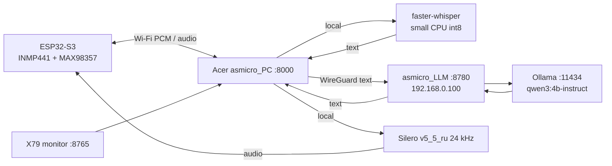

# Architecture / Архитектура

Design rule: audio recognition and synthesis stay on Acer; the GPU server receives text and performs memory/LLM work. This minimizes VPN audio traffic and keeps the RTX 3060 focused on inference.

Internal HTTP clients to `192.168.0.0/24` must bypass Windows proxy settings (`httpx(..., trust_env=False)`).
