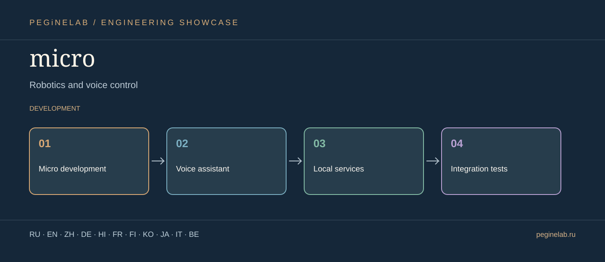

# micro · Graphical showcase

**Робототехника и голосовое управление / Robotics and voice control** · Micro development → Voice assistant → Local services → Integration tests · status: **development**.

**Internationalization scope:** these are translated descriptions, not a claim that the application's UI has eleven implemented languages. Features and limitations in the root README take precedence.

### Русский · ru
Экспериментальный репозиторий голосового помощника MICRO.. **micro** — Micro development → Voice assistant → Local services → Integration tests.

### English · en
Experimental MICRO voice-assistant development repository.. **micro** — Micro development → Voice assistant → Local services → Integration tests.

### 简体中文 · zh
MICRO 语音助手实验性开发仓库。. **micro** — Micro development → Voice assistant → Local services → Integration tests.

### Deutsch · de
Experimentelles Entwicklungsrepository für den Sprachassistenten MICRO.. **micro** — Micro development → Voice assistant → Local services → Integration tests.

### हिन्दी · hi
MICRO वॉइस असिस्टेंट का प्रयोगात्मक विकास रिपॉज़िटरी।. **micro** — Micro development → Voice assistant → Local services → Integration tests.

### Français · fr
Dépôt expérimental de développement de l'assistant vocal MICRO.. **micro** — Micro development → Voice assistant → Local services → Integration tests.

### Suomi · fi
MICRO-puheavustimen kokeellinen kehitysrepositorio.. **micro** — Micro development → Voice assistant → Local services → Integration tests.

### 한국어 · ko
MICRO 음성 비서의 실험적 개발 저장소.. **micro** — Micro development → Voice assistant → Local services → Integration tests.

### 日本語 · ja
ロボット工学と音声制御. **micro** — Micro development → Voice assistant → Local services → Integration tests.

### Italiano · it
Robotica e controllo vocale. **micro** — Micro development → Voice assistant → Local services → Integration tests.

### Беларуская · be
Робататэхніка і галасавое кіраванне. **micro** — Micro development → Voice assistant → Local services → Integration tests.

## Contact / Контакты

[Telegram @Feudorlab1](https://t.me/Feudorlab1) · [Phone +7 926 041 1145](tel:+79260411145)

[feudor.lab@yandex.ru](mailto:feudor.lab@yandex.ru) · [obzorniky@gmail.com](mailto:obzorniky@gmail.com) · [peginelab.ru](https://peginelab.ru/)

[Source repo](https://github.com/musikfed/micro)
